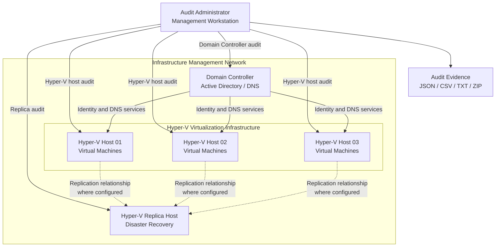
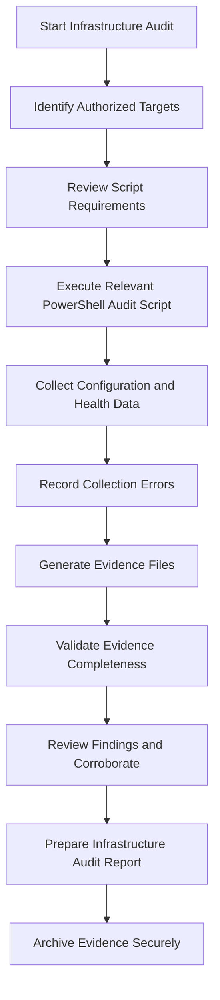

# Server Infrastructure Audit Framework

A PowerShell-based framework for collecting, organizing, and reviewing infrastructure audit evidence from Windows Server and Hyper-V environments.

The framework is intended to support repeatable technical assessments of server configuration, Active Directory, virtualization hosts, and disaster recovery components. It produces structured evidence files that can be reviewed during infrastructure audits and used as supporting material for audit reports.

> **Project status:** Scripts should be validated in a representative test environment before production use. Collection results depend on Windows Server versions, installed roles and modules, permissions, remoting configuration, and the target infrastructure.

---

## Table of Contents

- [Objectives](#objectives)
- [Scope](#scope)
- [Infrastructure Architecture](#infrastructure-architecture)
- [Audit Components](#audit-components)
- [Repository Structure](#repository-structure)
- [Requirements](#requirements)
- [Installation](#installation)
- [Execution](#execution)
- [Evidence Output](#evidence-output)
- [Audit Workflow](#audit-workflow)
- [Security and Data Handling](#security-and-data-handling)
- [Troubleshooting](#troubleshooting)
- [Validation and Testing](#validation-and-testing)
- [Limitations](#limitations)
- [Contributing](#contributing)
- [License](#license)

---

## Objectives

- Standardize the collection of infrastructure configuration and health information.
- Reduce repetitive manual evidence-gathering activities.
- Organize audit outputs into structured JSON, CSV, and text files.
- Support assessments of Domain Controllers, Hyper-V hosts, and disaster recovery components.
- Make collected evidence easier to review, compare, and reference in audit reports.
- Provide a reusable foundation that can be extended with additional audit modules.

## Scope

The repository is organized around these infrastructure areas:

| Area | Intended coverage |
|---|---|
| Domain Controller | Active Directory environment, DNS, services, operating-system information, security configuration, and relevant event logs |
| Hyper-V Host | Host operating system, hardware, storage, networking, Hyper-V configuration, and virtual machine inventory |
| Disaster Recovery | Hyper-V Replica configuration and status information where the feature is configured and accessible |
| Common | Shared functions for output creation, error handling, and evidence formatting |

The exact checks performed depend on the scripts present in the repository. Refer to each script's documentation and comments for its implemented collection scope.

---

## Infrastructure Architecture

The following diagram represents a **logical reference architecture** for a typical environment. It is illustrative and should be adapted to the actual customer or lab topology.

### Reference Infrastructure Topology



### Architecture Components

| Component | Role in the reference architecture |
|---|---|
| Audit Administrator / Workstation | Runs the audit scripts and reviews collected evidence |
| Domain Controller | Provides directory and DNS services; assessed by the Domain Controller audit script |
| Hyper-V Host 01 | Hosts virtual machines and is assessed independently |
| Hyper-V Host 02 | Hosts virtual machines and is assessed independently |
| Hyper-V Host 03 | Hosts virtual machines and is assessed independently |
| Hyper-V Replica Host | Represents a possible disaster recovery target for configured Hyper-V Replica relationships |
| Evidence Output | Stores the generated audit files for review and reporting |

**Architecture notes:**

- The diagram is a logical reference, not a verified network diagram.
- Dashed replication links indicate possible relationships only. They do not confirm that replication is enabled or healthy.
- The Domain Controller service links are conceptual and do not represent specific network paths or firewall rules.
- Host-level inventory does not automatically establish the health or configuration of guest operating systems.
- Replace the generic host labels with environment-specific labels only in controlled, access-restricted documentation.

---

## Audit Components

### 1. Domain Controller Audit

Script location:

```text
Scripts/Domain-Controller/DC-Server-Audit.ps1
```

Intended purpose:

- Collect Domain Controller and operating-system information.
- Gather selected Active Directory and DNS details.
- Review relevant services and security-related configuration.
- Collect selected event-log information.
- Save collected information as structured evidence.

The actual checks and output files are determined by the current script implementation.

### 2. Hyper-V Host Audit

Script location:

```text
Scripts/Hyper-V/HyperV-Host-Audit.ps1
```

Intended purpose:

- Collect Hyper-V host system information.
- Inventory virtual machines on the host.
- Gather virtual switch and networking information.
- Review storage and host configuration.
- Collect selected health and event information.

Host-level collection does not replace guest operating-system audits.

### 3. Hyper-V Replica / Disaster Recovery Audit

Script location:

```text
Scripts/Disaster-Recovery/HyperV-Replica-Audit.ps1
```

Intended purpose:

- Inspect Hyper-V Replica configuration where available.
- Collect replication-related status and configuration information.
- Record collection errors and unavailable data for follow-up.

A cmdlet error stating that replication is not enabled for a VM means that the queried Hyper-V Replica feature is not enabled for that VM. It does **not**, by itself, establish whether another replication or backup product is configured or healthy.

### 4. Common Functions

Directory:

```text
Scripts/Common/
```

Shared functions may be placed here as the framework grows. Examples include output-path handling, safe command execution, error recording, and evidence serialization. Scripts should document any shared module or helper-file dependency they require.

---

## Repository Structure

```text
Server-Infrastructure-Audit/
│
├── Scripts/
│   ├── Domain-Controller/
│   │   └── DC-Server-Audit.ps1
│   │
│   ├── Hyper-V/
│   │   └── HyperV-Host-Audit.ps1
│   │
│   ├── Disaster-Recovery/
│   │   └── HyperV-Replica-Audit.ps1
│   │
│   └── Common/
│
├── Documentation/
│   ├── Installation.md
│   ├── Execution-Guide.md
│   ├── Evidence-Collection.md
│   └── Troubleshooting.md
│
├── Architecture/
│   ├── Reference-Architecture.md
│   └── Audit-Workflow.md
│
├── Tests/
│   └── Script-Validation.md
│
├── Output/
│   └── .gitkeep
│
├── README.md
├── CHANGELOG.md
├── CONTRIBUTING.md
└── LICENSE
```

The structure above is the intended repository layout. A file should be considered available only after it has been added to the repository.

---

## Requirements

Review each script before execution. Typical requirements may include:

- A supported Windows Server environment appropriate to the target script.
- Windows PowerShell 5.1 unless the individual script explicitly documents another requirement.
- An account with sufficient read permissions for the information being collected.
- Elevated PowerShell when required by the commands used.
- The Hyper-V PowerShell module for Hyper-V-related collection.
- Active Directory PowerShell module for AD-specific collection, if used by the script.
- Network connectivity and appropriate firewall rules when collecting remotely.
- PowerShell remoting configuration if the script uses remote PowerShell sessions.

Do not assume every requirement applies to every script. Confirm the commands and dependencies in the script before running it.

---

## Installation

### 1. Clone the repository

```bash
git clone https://github.com/3ls3if/Server-Infrastructure-Audit.git
cd Server-Infrastructure-Audit
```

If the repository is private, authenticate with GitHub before cloning.

### 2. Transfer scripts to the audit workstation

Run the scripts from a Windows audit workstation or an approved management server. Copy or clone the repository to a controlled local directory.

### 3. Review the script

Before execution:

1. Open the script in a text editor.
2. Review all commands and target references.
3. Confirm required modules and permissions.
4. Confirm output locations and available disk space.
5. Confirm that the script does not contain hard-coded customer credentials or unintended external destinations.

### 4. Check the execution policy

Inspect the current policy:

```powershell
Get-ExecutionPolicy -List
```

Follow your organization's PowerShell execution policy. Do not weaken machine-wide security settings simply to run an audit script. If an approved process permits a one-process execution-policy override, use it only after reviewing the script and obtaining the required authorization.

---

## Execution

Run PowerShell as an account authorized to perform the relevant read-only audit activities.

### Domain Controller Audit

```powershell
Set-Location "C:\Path\To\Server-Infrastructure-Audit"
.\Scripts\Domain-Controller\DC-Server-Audit.ps1
```

### Hyper-V Host Audit

```powershell
Set-Location "C:\Path\To\Server-Infrastructure-Audit"
.\Scripts\Hyper-V\HyperV-Host-Audit.ps1
```

### Hyper-V Replica Audit

```powershell
Set-Location "C:\Path\To\Server-Infrastructure-Audit"
.\Scripts\Disaster-Recovery\HyperV-Replica-Audit.ps1
```

These are example invocation commands. If a script defines parameters, pass the required values as documented in that script's help or parameter block.

To inspect a script's declared parameters:

```powershell
Get-Command .\Scripts\Domain-Controller\DC-Server-Audit.ps1 -Syntax
```

For script-based help, if available:

```powershell
Get-Help .\Scripts\Domain-Controller\DC-Server-Audit.ps1 -Full
```

---

## Evidence Output

The framework is intended to produce structured evidence files such as:

| Format | Typical use |
|---|---|
| JSON | Structured configuration and system data |
| CSV | Tabular inventories and records |
| TXT | Command output and readable summaries |
| ZIP | Packaging collected evidence for transfer or review |

The exact output names and folder layout depend on each script's implementation.

### Evidence handling recommendations

- Keep evidence grouped by target server and collection date.
- Preserve original outputs; perform analysis on copies.
- Record collection errors separately from confirmed findings.
- Record the script version and execution time with the audit package.
- Restrict access to evidence because it may contain hostnames, IP addresses, domain details, usernames, software versions, and security configuration.
- Do not commit real customer evidence to the source-code repository.

---

## Audit Workflow



### Recommended review process

1. Confirm the audit scope and written authorization.
2. Identify the in-scope servers and infrastructure roles.
3. Select the relevant audit scripts.
4. Review script prerequisites and permissions.
5. Execute collection during the approved audit window.
6. Check the output for missing data and collection errors.
7. Validate significant observations against the target system.
8. Distinguish confirmed findings, informational observations, and collection limitations.
9. Prepare the audit report with evidence references.
10. Store the evidence in an approved, access-controlled location.

---

## Security and Data Handling

Infrastructure audit evidence can contain sensitive operational information.

- Never store passwords, API keys, tokens, or private keys in scripts or repository files.
- Do not commit customer IP addresses, public endpoints, domain names, server names, or internal network diagrams unless explicitly approved.
- Keep customer-specific configuration in a separate, access-controlled location.
- Use least-privilege accounts appropriate to the checks being performed.
- Obtain authorization before running scripts against production systems.
- Avoid making configuration changes during evidence collection unless a separately approved remediation task requires them.
- Review evidence packages before sharing them outside the organization.
- Add generated output and customer evidence to `.gitignore` where appropriate.

Example `.gitignore` entries:

```gitignore
# Audit output and evidence
Output/*
!Output/.gitkeep

# Collected evidence packages
*.zip
*.evtx
*.bak

# Local environment and customer-specific configuration
*.local.ps1
customer-config/
evidence/
```

Review these exclusions against your workflow before adopting them. Do not exclude source files or documentation that should be version-controlled.

---

## Troubleshooting

| Symptom | Possible explanation | Recommended check |
|---|---|---|
| Access denied | Current account lacks required permissions | Confirm the account and required rights for the specific command |
| Hyper-V cmdlets not found | Hyper-V PowerShell module is unavailable | Check whether the Hyper-V role or management tools are installed |
| Active Directory cmdlets not found | AD PowerShell module is unavailable | Check RSAT / AD DS management tools |
| Remote collection fails | Remoting, DNS, firewall, or authentication issue | Test name resolution, connectivity, WinRM, and authorization |
| Some JSON or CSV files are empty | The source command returned no data or collection failed | Review the script's error output and validate the command manually |
| Replica query reports replication is not enabled | Hyper-V Replica is not enabled for the queried VM | Confirm the intended DR technology and assess it using the appropriate tooling |
| Event-log query returns no records | No matching events were returned or access is restricted | Confirm the log exists, the query scope, and permissions |

A collection error is not automatically an infrastructure failure. Record the error and investigate it before drawing an audit conclusion.

---

## Validation and Testing

Before using a script for a formal audit:

- Test it on a non-production system or representative lab.
- Confirm compatibility with the target PowerShell and Windows Server versions.
- Verify that required modules and cmdlets are available.
- Test behavior when optional roles or features are absent.
- Test behavior when a command returns no records.
- Test behavior when access is denied or a remote target is unavailable.
- Confirm that output files are valid and contain the expected fields.
- Confirm that errors are captured without silently presenting incomplete evidence as a successful collection.
- Review the output manually against the target system.

Do not describe a script as production-ready or fully tested until the relevant validation has actually been completed and recorded.

---

## Limitations

- Collection coverage is limited to checks implemented in the scripts.
- Results depend on permissions, installed modules, operating-system versions, and target configuration.
- Host-level Hyper-V inventory does not constitute a guest operating-system security audit.
- Hyper-V Replica checks do not automatically assess third-party replication, backup, or disaster recovery products.
- A successful script run does not guarantee that every check returned complete data.
- The framework supports evidence collection; audit conclusions still require technical review and corroboration.

---

## Contributing

Contributions and improvements are welcome.

When contributing:

1. Keep scripts compatible with the documented PowerShell version where practical.
2. Use clear variable names and comments.
3. Handle missing roles, optional features, and empty command results safely.
4. Capture errors with enough context to support investigation.
5. Avoid hard-coded customer-specific values and credentials.
6. Test changes in a lab before submitting them.
7. Update the relevant documentation when script behavior or output changes.

---

## License

See the [`LICENSE`](LICENSE) file for the applicable terms. If no license file has been added, usage and redistribution permissions have not yet been defined.

---

## Disclaimer

This framework is provided as an infrastructure audit and evidence-collection aid. Review scripts before execution and use them only on systems for which you have authorization. The framework does not replace independent validation, professional security assessment, backup verification, or formal disaster recovery testing.
